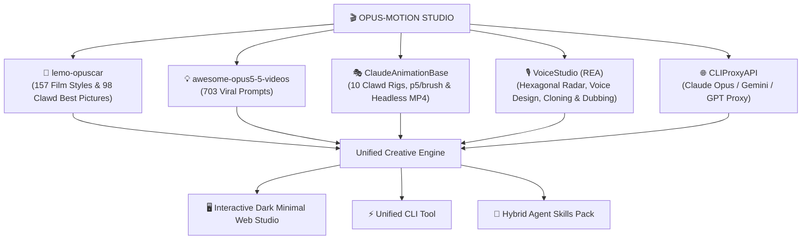

# 🎬 OPUS-MOTION

[English](README.md) · [简体中文](README.zh-CN.md) · [Directing Guide](DIRECTOR.md) · [Technique & Architecture](TECHNIQUE.md) · [Agent Instructions](AGENTS.md)

> **All-in-One AI Film Studio, 157 Code Animation Styles (including all 98 Clawd Oscar Best Picture Nominees), 10 Rigged Clawd Character Personas, 703 Viral Video Prompts, VoiceStudio REA Voice Cloning & Radar, and Multi-Model LLM Gateway.**

[](https://github.com/Entelechae/opus-motion/actions/workflows/ci.yml)
[](https://github.com/Entelechae/opus-motion/actions/workflows/pages.yml)
[](LICENSE)
[](data/styles.json)
[](studio/app.js)
[](data/prompts.json)
[](core/voice_engine.py)

---

## 🌟 What is Opus-Motion?

**Opus-Motion** is an open-source generative film studio and code animation synthesizer uniting five state-of-the-art creative technologies:
1. **[lemo-opuscar](https://github.com/lemomo-ai/lemo-opuscar):** 157 aesthetic film styles with shot lists, film references, prompt specifications, and all 98 Clawd Oscar Best Picture Nominees (1927–2025).
2. **awesome-opus5-5-videos:** 703 viral creative coding prompts for Canvas 2D, Three.js, WebGL shaders, p5.js, and GSAP.
3. **ClaudeAnimationBase:** 10 rigged Clawd character personas, p5.brush watercolor physics, and headless MP4 rendering.
4. **VoiceStudio (REA):** Reverse-Engineered Audio (REA) 6-axis hexagonal quality radar, acoustic formant profiler ($F_1, F_2, F_3$), voice cloning, and speech viseme lip-synchronization.
5. **CLIProxyAPI / Entelechae Gateway:** High-concurrency proxy routing and multi-account load balancing for Claude Opus, Gemini 2.5/Flash, GPT-4o, and Entelechae-code.



---

## ⚡ Quickstart

### Prerequisites
- Python 3.9+ or [uv](https://docs.astral.sh/uv/)
- Node.js 18+ (optional, for headless Chrome rendering)
- FFmpeg (for MP4 muxing and audio mastering)

### 1. Installation
```bash
git clone https://github.com/Entelechae/opus-motion.git
cd opus-motion
pip install -e .
```

### 2. Configure Environment
Copy the `.env.example` template:
```bash
cp .env.example .env
```
Set your preferred LLM gateway credentials (works with standard OpenAI, Anthropic, Gemini, or local CLIProxyAPI gateways).

### 3. Launch Web Studio
```bash
# Launch interactive developer studio on http://localhost:5173
opus-motion studio
# or
python server.py
```

---

## 🖥️ Studio Features

- 🎨 **Styles Directory (157 Styles):** Browse open cinema styles and 98 Clawd Oscar Best Picture milestones. Filter by category, inspect production prompt cards, and preview full-res video frame references.
- 💡 **Viral Prompts (703 Prompts):** Search real viral prompts by author and tech stack (`threejs`, `canvas`, `svg`, `shader`).
- 🎬 **Studio Director Stage:** Scrub through time $t$ on a 60fps deterministic canvas. Cast any of the **10 Clawd Character Personas** (`cyberpunk`, `rubberhose`, `pixel`, `claymation`, `origami`, `watercolor`, `noir`, `cosmic`), cycle emotions, and direct camera angles.
- 🎙️ **VoiceStudio REA Cloner:**
  - **6-Axis Hexagonal Audio Radar:** Real-time analysis of SNR (>25dB), clipping (0%), duration (5-15s), dead air, RMS dynamic energy, and pitch stability.
  - **Formant Resonances ($F_1, F_2, F_3$):** Real-time acoustic frequency profiling.
  - **Parametric Voice Design:** 6 built-in vocal archetypes (Sir David, Noir Detective, Anime Heroine, Clawd Mascot, Cyber AI, Master Oogway) plus natural language voice sculpting.
  - **Stage Dubbing Sync:** Seamlessly syncs dialogue audio directly to canvas character mouth visemes.
- 🌐 **LLM Proxy Playground:** Test and monitor upstream AI provider routing with live token telemetry.

---

## 🛠️ CLI Reference

```bash
# Search film styles
opus-motion styles -q "anime"
opus-motion styles --category Cinema

# Inspect viral prompts
opus-motion prompts -t "threejs" -n 5

# Generate complete autonomous director prompt
opus-motion director --style "hd-2d" --topic "Ancient clocktower in the clouds" --duration 30

# List cloned voice profiles
opus-motion voice --list

# Clone voice from a reference audio file
opus-motion voice --clone reference.wav --name "NarratorPrime"

# Check LLM proxy gateway connection
opus-motion proxy
```

---

## 🎭 Clawd Character Rigs

| Rig | Key | Aesthetic Description |
|---|---|---|
| **Original Warm Clawd** | `clawd` | Authentic Anthropic terracotta `#D97757` silhouette with squash-and-stretch |
| **Cyberpunk Clawd** | `cyberpunk` | Neon visor, holographic circuitry, and RGB glitch displacement |
| **1930s Rubberhose** | `rubberhose` | Pie-eyes, bendy limbs, film grain, and 12fps rhythmic stepping |
| **8-Bit Pixel Clawd** | `pixel` | Crisp orthogonal pixel grid with retro arcade palettes |
| **Claymation Clawd** | `claymation` | Organic tactile textures, fingerprint normals, and stop-motion stepping |
| **Low-Poly Clawd** | `lowpoly` | Faceted geometric vertices with directional Gouraud/PBR shading |
| **Origami Fold Clawd** | `origami` | Crisp papercraft creases, shadow depths, and unfolding transitions |
| **Watercolor Clawd** | `watercolor` | Capillary fluid bleeds, pigment pooling, and wet-on-wet brush strokes |
| **Noir Detective Clawd** | `noir` | Trenchcoat silhouette, Venetian blind lighting, and smoke drift |
| **Cosmic Astral Clawd** | `cosmic` | Nebular starfield particles, celestial glow, and radiant aura |

---

## 📚 Documentation & Guides

- [`DIRECTOR.md`](DIRECTOR.md) — Directing philosophy, 3-act micro-arcs, shot lists, staging, and rhythm.
- [`TECHNIQUE.md`](TECHNIQUE.md) — Technical rendering, Canvas 2D / Three.js math, Levinson-Durbin LPC formants, and viseme lip-sync.
- [`AGENTS.md`](AGENTS.md) — Instructions for AI coding assistants (Claude, Gemini, Antigravity).
- [`MAINTAINING.md`](MAINTAINING.md) — Guide for catalog curation, adding styles, and releases.

---

## 📄 License

Distributed under the [MIT License](LICENSE). Copyright © 2026 Antigravity & Entelechae.
